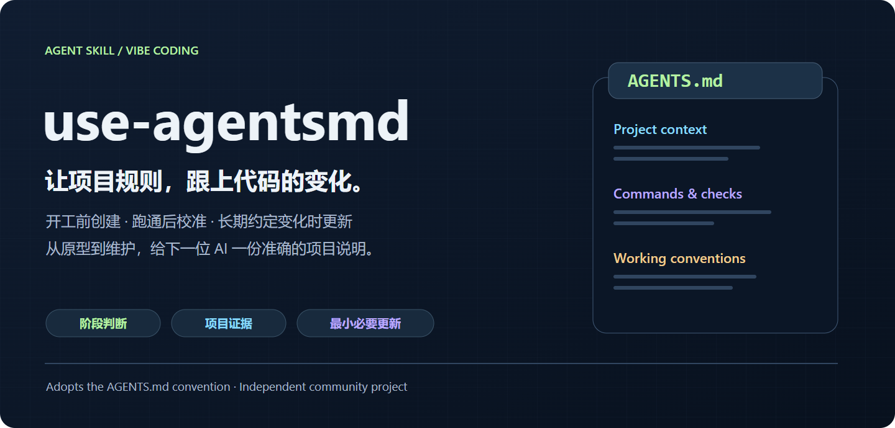
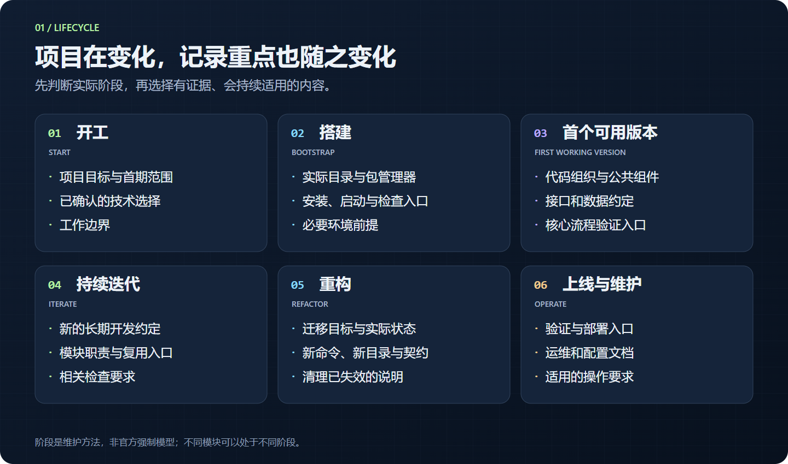
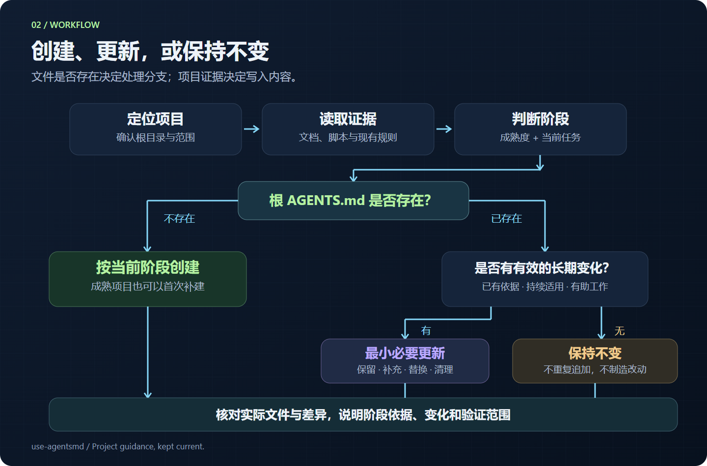
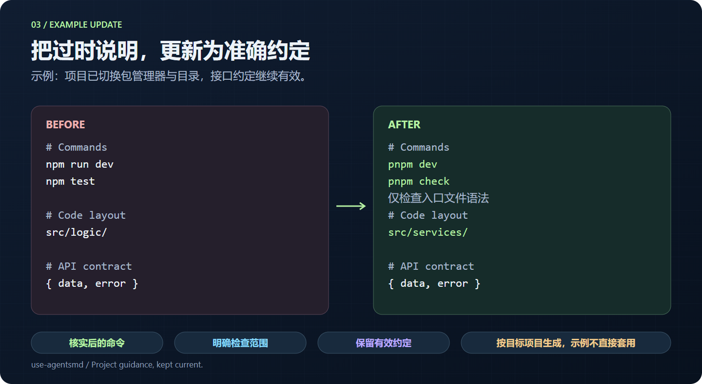
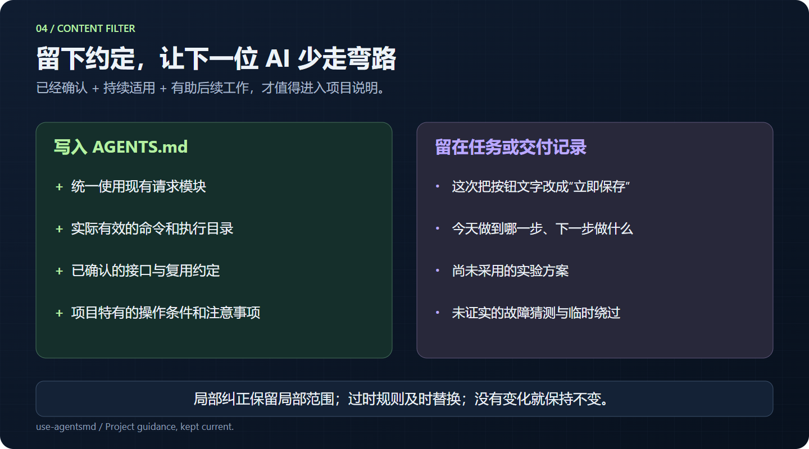

<div align="center">



# use-agentsmd

**Keep AGENTS.md in step with your project.**

Stage-aware · Grounded in project evidence · Minimal updates

[](docs/validation.md)
[](https://github.com/YuanYCoding/use-agentsmd/releases)
[](LICENSE)
[](https://agents.md/)

[中文文档](README.md) · [Install](#install) · [Usage](#usage) · [Attribution](#attribution)

</div>

An instruction-based Agent Skill for maintaining project guidance during Vibe coding. It identifies the project and its stage, inspects the root `AGENTS.md`, then **creates, updates, or leaves it unchanged**.

> **Built using the convention, guidance, and examples from [agentsmd/agents.md](https://github.com/agentsmd/agents.md) and [agents.md](https://agents.md/).** This independent community project adds a stage-aware maintenance workflow. It is not affiliated with or officially endorsed by AGENTS.md maintainers or OpenAI.

## Install

In a Codex environment with the built-in installer:

```text
$skill-installer

Install the skill at skills/use-agentsmd from
https://github.com/YuanYCoding/use-agentsmd
```

Alternatively, download a [release](https://github.com/YuanYCoding/use-agentsmd/releases) or clone the repository and copy `skills/use-agentsmd/` to a supported skill location. Current Codex documentation lists `~/.agents/skills/` for user skills and `.agents/skills/` for repository skills. Existing installer versions may use a different destination; check their actual output and avoid duplicate installations. See the [official documentation](https://learn.chatgpt.com/docs/build-skills#where-to-save-skills).

The skill has no standalone runtime, background process, API key, or MCP dependency. Your host agent needs access to read and edit the target project. If the installed skill does not appear, restart the host as appropriate.

## Usage

```text
$use-agentsmd

Identify the current development stage, inspect the project's root
AGENTS.md, and create or update it only where needed.
```

Specify a target directory when the current workspace contains multiple projects. Add context such as “the first working version is complete” or “we just migrated the package manager” when useful.

For a read-only review:

```text
$use-agentsmd

Review AGENTS.md for stale guidance and report recommendations.
Do not modify files yet.
```

## What it does

| Capability | Behavior |
| --- | --- |
| Recognize stages | Distinguish overall project maturity from the current task |
| Create missing guidance | Write for the actual stage, even when an established project lacks AGENTS.md |
| Maintain existing rules | Preserve valid guidance, add confirmed conventions, replace stale instructions |
| Check evidence | Inspect manifests, scripts, configuration, paths, and relevant documentation |
| Filter temporary context | Keep durable guidance and leave one-off requests or speculative fixes in task records |
| Respect scope | Keep shared guidance at the root and module-specific differences in nested files when appropriate |
| Avoid unnecessary edits | Leave file content and modification time unchanged when no meaningful update is needed |

## Six stages



| Stage | Documentation focus |
| --- | --- |
| Start | Purpose, initial scope, confirmed choices, working boundaries |
| Bootstrap | Real directories, dependency tools, setup and check commands |
| First working version | Code organization, shared components, contracts, validation entry points |
| Iterate | New durable conventions, module responsibilities, relevant checks |
| Refactor | Separate migration intent from implemented facts; replace stale instructions |
| Operate | Validation and deployment entry points, runbooks, configuration, operating requirements |

This lifecycle is a method designed by this project, not a mandatory part of the official AGENTS.md format.

## Decision flow



The agent locates the project, reads relevant evidence, determines stage, filters candidate guidance, edits within scope, and checks the resulting document. File existence and project maturity are separate decisions.

## An update example



The illustration is an example, not a fixed template. Commands, paths, and conventions must be confirmed against the target project. A syntax check is not a business-flow test, and a deployment configuration is not proof of a live deployment.

## What belongs in the file



Save guidance when it is supported, likely to remain relevant, and useful to the next agent. Do not turn a local correction into a universal ban. Replace obsolete rules instead of appending a history of every decision.

## Attribution

This project adopts and references the [AGENTS.md project](https://github.com/agentsmd/agents.md) and [website](https://agents.md/) for the format's purpose, ordinary Markdown structure, content suggestions, nested instructions, and examples.

The six-stage model, evidence-selection rules, and minimal-update process are this skill's own workflow. The upstream website is not bundled or required as a runtime dependency. Project-specific examples, including the upstream site's development build restrictions, are not universal rules.

Sources and the reviewed snapshot are included in [the content guide](skills/use-agentsmd/references/agentsmd-content-guide.md). See [NOTICE.md](NOTICE.md) for upstream licensing and relationship details.

## Validation and limits

Five isolated scenarios have been exercised, including repeated calls and a workspace with nested guidance. Observed results and boundaries are recorded in [docs/validation.md](docs/validation.md). The validation notes and skill instructions are primarily in Chinese.

The local repository checker validates package metadata, local references, and image integrity. It does not execute an LLM or prove that the skill will make the right judgment in every project. These checks were run for the initial release; GitHub Actions is not configured in this version. Agent capability and available project evidence still matter. This is not a background monitor.

## Contributing

Provide a sanitized, minimal reproduction of missed rules, incorrect scope, or unnecessary rewrites. See [CONTRIBUTING.md](CONTRIBUTING.md).

## License

[MIT](LICENSE) © 2026 YuanYCoding. Original documentation and illustrations use the same license. Upstream names and marks belong to their respective owners.
