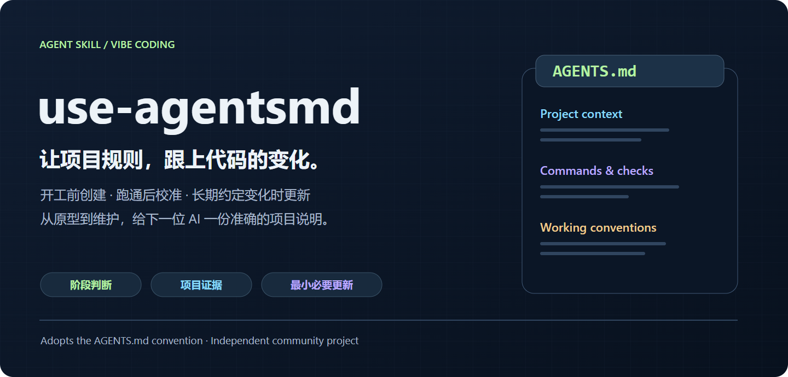
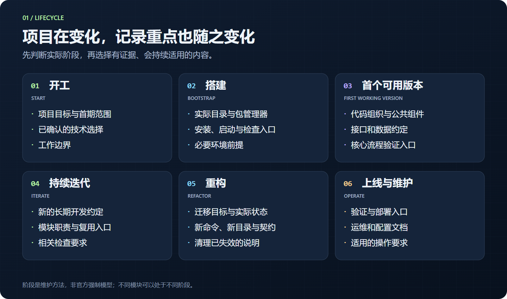
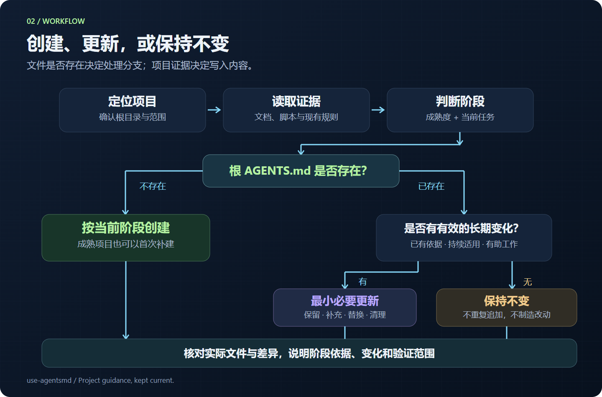
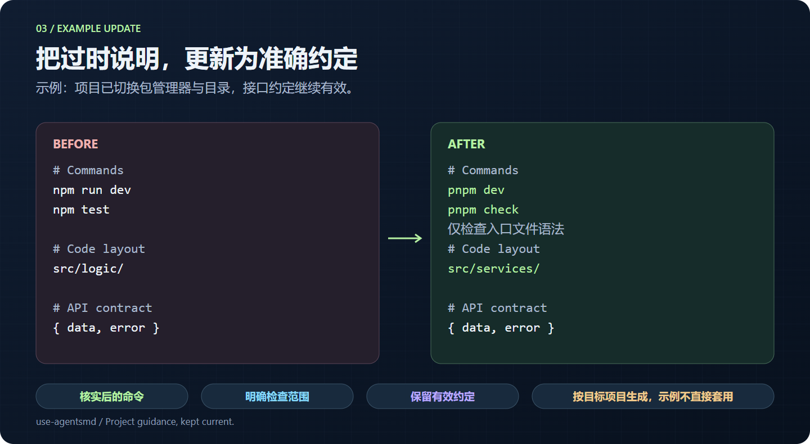
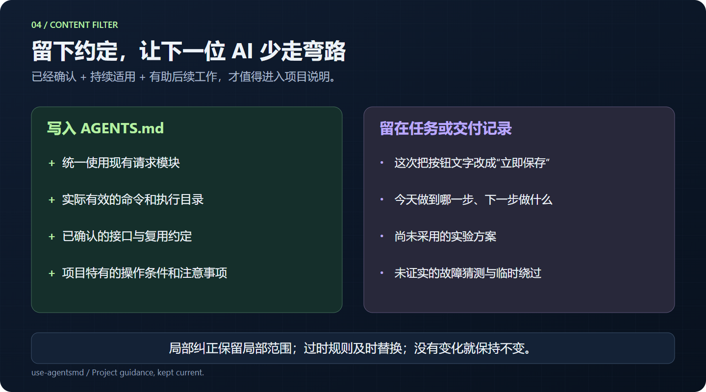

<div align="center">



# use-agentsmd

**让 AGENTS.md 随项目一起成长。**

识别开发阶段 · 基于项目证据 · 最小必要更新

[](docs/validation.md)
[](https://github.com/YuanYCoding/use-agentsmd/releases)
[](LICENSE)
[](skills/use-agentsmd/SKILL.md)
[](https://agents.md/)

[快速开始](#quick-start) · [功能](#features) · [使用场景](#usage) · [工作原理](#workflow) · [官方来源](#upstream) · [English](README.en.md)

</div>

`use-agentsmd` 是一个面向 **Vibe coding** 的 Agent Skill。它会先理解当前项目，再判断开发阶段，检查根目录中的 `AGENTS.md`，完成**创建、更新或保持不变**。

它适合这样的开发节奏：你通过对话快速搭建原型、增加功能、修正方向；重要约定逐渐形成，旧命令和旧路径也逐渐失效。这个 Skill 帮你把已经确认、后续仍需遵守的内容留在项目里。

> [!NOTE]
> **本项目采用并参考 [AGENTS.md](https://github.com/agentsmd/agents.md) 开源项目及其[官网](https://agents.md/)的开放文件约定、内容建议和示例。** 在此基础上，增加了 Vibe coding 阶段判断、证据核对和持续维护流程。这是独立社区项目，与 AGENTS.md 维护方及 OpenAI 没有隶属或官方背书关系。详见[来源与致谢](#upstream)。

<a id="quick-start"></a>
## 快速开始

### 1. 安装 Skill

在支持 `$skill-installer` 的 Codex 环境中发送：

```text
$skill-installer

请从 https://github.com/YuanYCoding/use-agentsmd 安装
skills/use-agentsmd 目录中的 Skill。
```

也可以[下载发布包](https://github.com/YuanYCoding/use-agentsmd/releases)，或克隆后手动复制。下面的命令安装到 Codex 当前文档列出的用户级目录；目标已存在时先比较内容，避免覆盖自己的定制。

<details>
<summary><b>macOS / Linux</b></summary>

```bash
git clone https://github.com/YuanYCoding/use-agentsmd.git
mkdir -p "$HOME/.agents/skills"
if [ -e "$HOME/.agents/skills/use-agentsmd" ]; then
  echo "use-agentsmd already exists; compare before updating."
else
  cp -R use-agentsmd/skills/use-agentsmd "$HOME/.agents/skills/"
fi
```

</details>

<details>
<summary><b>Windows PowerShell</b></summary>

```powershell
git clone https://github.com/YuanYCoding/use-agentsmd.git
$skillRoot = Join-Path $HOME '.agents\skills'
$skillTarget = Join-Path $skillRoot 'use-agentsmd'
New-Item -ItemType Directory -Force -Path $skillRoot | Out-Null
if (Test-Path -LiteralPath $skillTarget) {
    Write-Host 'use-agentsmd 已存在，请先比较再更新。'
} else {
    Copy-Item -LiteralPath '.\use-agentsmd\skills\use-agentsmd' -Destination $skillRoot -Recurse
}
```

</details>

团队共享时，可将 `skills/use-agentsmd/` 复制到目标仓库的 `.agents/skills/use-agentsmd/`。安装器和不同宿主版本的路径可能不同，以实际安装结果为准；避免在多个发现目录中重复安装同名 Skill。Codex 会检测技能变化，未显示时可重新启动。参见[官方技能文档](https://learn.chatgpt.com/docs/build-skills#where-to-save-skills)。

**这个 Skill 本身只包含指令、界面元数据和参考文件，没有后台进程，也不需要 API Key、MCP 服务或独立运行时。** 执行时需要宿主 Agent 能读取和编辑目标项目。

### 2. 在项目中调用

```text
$use-agentsmd

请判断当前项目所处的 Vibe coding 阶段，
检查项目根目录的 AGENTS.md，并完成必要的创建或更新。
```

如果当前目录包含多个项目，补充目标路径。若已知阶段，可以补充一句“首个可用版本已经跑通”或“刚完成包管理器迁移”，帮助 Agent 缩小判断范围。

### 3. 查看结果

Agent 会交代目标文件、阶段及依据、创建／更新／无需修改的结果、主要变化，以及实际完成的核对。存在影响使用的不确定信息时会说明。

> **已有文件且没有长期变化时，保持不变就是有效结果。** Skill 不会为了“完成一次调用”而改写措辞、增加日期或追加重复规则。

<a id="features"></a>
## 能做什么

| 能力 | 具体行为 |
| --- | --- |
| 阶段判断 | 分别判断项目整体成熟度与当前任务阶段，允许成熟项目处于局部重构中 |
| 首次创建 | 根目录缺少 AGENTS.md 时，按照项目实际阶段创建；不会把文件缺失等同于项目刚开始 |
| 持续更新 | 保留有效规则，补充新约定，替换失效说明，清理重复和冲突 |
| 项目证据核对 | 查看实际清单、脚本、配置、目录、文档和相关改动，不编造命令与路径 |
| 内容筛选 | 提炼已确认且持续适用的约定，避免将一次性需求和临时排障结论永久化 |
| 模块分层 | 根文件承载公共约定，确有差异时才处理子目录 AGENTS.md |
| 官方参考 | 内置经过整理的 AGENTS.md 内容生成参考，区分通用约定与示例项目规则 |
| 可重复调用 | 同样的事实再次调用时，目标是保持内容与修改时间稳定 |

<a id="lifecycle"></a>
## 六个阶段，六种维护重点



| 阶段 | 什么时候调用 | 重点记录什么 |
| --- | --- | --- |
| **开工** | 准备进入实际实现 | 项目目标、首期范围、已确认技术选择、工作边界 |
| **搭建** | 脚手架与运行方式初步形成 | 目录职责、包管理器、安装／启动方式、现有检查命令 |
| **首个可用版本** | 核心流程已有确认或验证依据 | 代码组织、公共组件、接口与数据约定、核心验证入口 |
| **持续迭代** | 功能完成后出现长期变化 | 新的公共约定、模块职责变化、复用与检查要求 |
| **重构** | 调整技术栈、目录、接口或流程 | 区分迁移目标与已落地事实，替换旧说明和失效引用 |
| **上线与维护** | 准备发布或进入运行维护 | 验证与部署入口、运维文档、配置说明、操作要求 |

这六个阶段是本项目为 Vibe coding 设计的工作方法，**不是 AGENTS.md 官方规定的阶段模型**。阶段也不要求单向推进；同一个仓库的不同模块可能处于不同阶段。

<a id="usage"></a>
## 常见使用方式

### 新项目：先形成简版

```text
$use-agentsmd

我要开始做一个个人读书记录工具。
首期支持书名、阅读状态和简短笔记，技术栈尚未确定。
请根据现有信息管理项目的 AGENTS.md。
```

预期：保存已确认目标与范围；有依据后再补充技术、目录和命令。

### 首个可用版本：整理已经形成的约定

```text
$use-agentsmd

任务创建和列表流程已经手工验收通过，准备继续增加功能。
请结合实际代码整理代码组织、公共组件、接口约定和验证入口。
```

### 重构后：替换旧说明

```text
$use-agentsmd

我们刚把包管理器切换为 pnpm，并将业务逻辑迁到 src/services。
请核对实际文件，更新 AGENTS.md 中相关命令和目录说明。
```

### 交接前：复查当前规则

```text
$use-agentsmd

我准备新开对话继续开发。
请检查 AGENTS.md 的关键命令、目录和长期约定是否仍然有效。
```

### 只想检查：明确只读范围

```text
$use-agentsmd

请只检查 AGENTS.md 是否过时，列出建议，暂不修改文件。
```

更多阶段示例见 [docs/examples.md](docs/examples.md)。

<a id="workflow"></a>
## 它如何决定创建、更新或不修改



1. **定位项目**：结合目标路径、当前任务、工作区和项目清单确认根目录。
2. **读取上下文**：检查适用的说明文件与相关项目证据。
3. **判断阶段**：区分当前成熟度、正在进行的任务和证据局限。
4. **筛选内容**：判断某条信息是否已经确认、持续适用，并能减少后续误操作或重复探索。
5. **落盘或保持不变**：创建必要内容，或在已有文档上最小更新。
6. **核对并交付**：检查路径、链接、命令定义、范围及差异，如实说明实际验证。

文件内容存在、命令已定义、任务已经实现、功能已经验证是不同状态。Skill 要求 Agent 区分它们，不用一个状态替代另一个状态。

## 更新效果示意



上图是说明性示例：目标项目已确认改用 pnpm，业务逻辑已迁移，现有检查只覆盖语法。实际输出会依据你的项目生成，不套用图中的路径或命令。

## 哪些信息应该留下



可以用三个问题快速判断：

- 这件事是否已经由用户确认，或有项目证据支持？
- 它是否会持续影响后续开发？
- 下一位没有参与当前对话的 AI，不知道它是否容易做错？

例如，“今后的确认弹窗复用现有组件”可能成为规则；“这个按钮先试一下蓝色”通常属于当前任务。一次局部纠正也不应自动扩大为全项目的永久禁令。

## 文件结构

```text
use-agentsmd/
├── skills/use-agentsmd/        # 安装这一目录
│   ├── SKILL.md               # 阶段判断与维护流程
│   ├── agents/openai.yaml     # 界面元数据
│   └── references/
│       └── agentsmd-content-guide.md
├── docs/
│   ├── images/                # README 配图：PNG + 可编辑 SVG
│   ├── examples.md            # 更多使用示例
│   └── validation.md          # 验证范围和行为案例
├── scripts/                   # 文档与发布包维护工具
├── CONTRIBUTING.md
├── NOTICE.md                  # 上游来源和项目关系
└── LICENSE
```

<a id="upstream"></a>
## 使用 AGENTS.md 项目：来源与致谢

感谢 **[agentsmd/agents.md](https://github.com/agentsmd/agents.md)** 提供开放、简单、可跨工具采用的项目说明约定。

| 来源 | 本 Skill 如何使用 |
| --- | --- |
| [AGENTS.md 官网](https://agents.md/) | 采用“为编程 Agent 提供上下文与工作说明”的定位、普通 Markdown 格式及持续维护思路 |
| [官方使用指南](https://github.com/agentsmd/agents.md/blob/main/components/HowToUseSection.tsx) | 参考推荐内容范围，以及根目录与子项目说明的组织方式 |
| [官方 README](https://github.com/agentsmd/agents.md/blob/main/README.md) | 借鉴开发环境、测试和 PR 指导的具体写法，并要求按目标项目重新核实 |
| [官方 FAQ](https://github.com/agentsmd/agents.md/blob/main/components/FAQSection.tsx) | 参考格式、冲突、检查、兼容性和旧名称迁移说明，保留宿主实现差异 |
| [官方仓库自身的 AGENTS.md](https://github.com/agentsmd/agents.md/blob/main/AGENTS.md) | 学习“规则、场景、原因、正确做法”的表达方式；其中的 Next.js 开发约定不作为通用要求 |

**本项目使用的是 AGENTS.md 的约定、文档与示例作为设计依据。** 没有打包其官网程序，也没有将其作为必须安装的运行依赖。六阶段模型、证据筛选、最小更新和重复调用策略是本项目的维护流程。

具体引用与核对快照位于 [内容生成参考](skills/use-agentsmd/references/agentsmd-content-guide.md)。上游仓库采用 MIT 许可证，相关归属说明见 [NOTICE.md](NOTICE.md)。

## 验证与实际边界

已在隔离项目中验证过：开工创建、成熟项目补建、重构更新、一次性文案不入长期规则，以及带子模块的工作区。重复调用检查了文件内容和修改时间。完整范围见 [验证记录](docs/validation.md)。

仓库提供本地检查脚本，用于核对文件结构、元数据、引用和图片完整性；**这些检查不等于对模型判断或真实项目运行结果的保证**。实际质量仍取决于宿主 Agent、可读的项目证据和用户提供的上下文。首版已执行本地检查，暂未配置 GitHub Actions。

## FAQ

<details>
<summary><b>每完成一个功能都要修改 AGENTS.md 吗？</b></summary>

可以检查一次，但只有形成长期变化时才修改。保持不变是正常结果。

</details>

<details>
<summary><b>没有 AGENTS.md，就一定生成开工模板吗？</b></summary>

不会。文件是否存在决定创建还是更新，项目证据决定内容重点。已上线的项目会按当前维护需要补建。

</details>

<details>
<summary><b>会自动一直维护吗？</b></summary>

没有后台监控或定时任务。宿主可以根据描述选择 Skill，也可以显式调用；具体触发和加载行为以宿主为准。建议在阶段切换、重要重构和交接时主动调用。

</details>

<details>
<summary><b>会帮我运行测试或部署吗？</b></summary>

默认任务是维护说明文件，并核对静态证据。写入“后续开发应运行某检查”不表示本次已运行，也不授予额外部署权限。

</details>

<details>
<summary><b>能在其他 AI 编程工具里使用吗？</b></summary>

核心指令使用 Markdown，可以供支持 Agent Skills 的宿主评估采用。当前维护和隔离验证以 Codex 环境为主，未逐一验证其他产品。Skill 的加载方式与生成的 AGENTS.md 的读取方式是两件事，应分别确认。

</details>

<details>
<summary><b>它会把现有文档全部重写吗？</b></summary>

默认保留现有语言、风格、有效规则及用户修改，优先局部更新。子目录文件只在确有模块差异时处理。

</details>

## 参与贡献

欢迎提交可复现的规则遗漏、错误推断或重复改写案例。提供脱敏后的最小项目结构、原始文档、请求和实际结果，往往比增加一条宽泛规则更有帮助。

参见 [贡献指南](CONTRIBUTING.md) · [提交问题](https://github.com/YuanYCoding/use-agentsmd/issues) · [版本记录](CHANGELOG.md)。

## 许可证

[MIT](LICENSE) © 2026 YuanYCoding。文档与原创配图同样采用 MIT 许可证；上游项目及商标归各自权利人所有。
